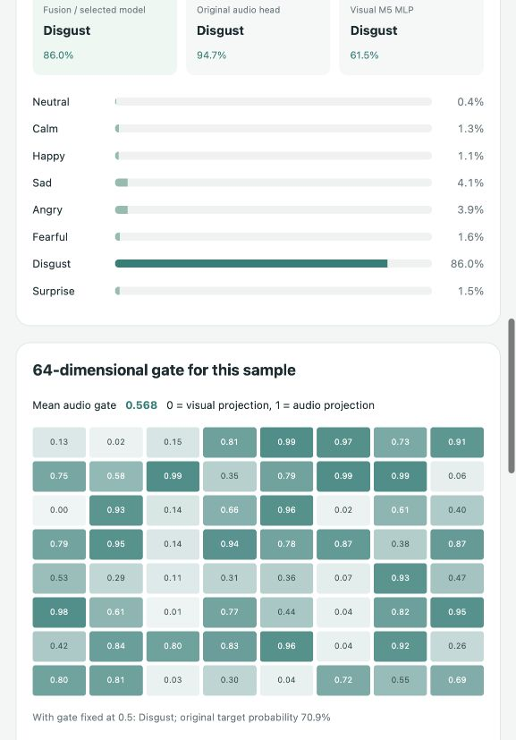

# Multimodal Emotion Recognition

**Group 13 · Pattern Recognition Systems · 2026**

An audio–visual emotion recognition system combining speech encoders, facial features and multimodal fusion. The project includes the M1–M5 implementations, trained models, reproducible experiment records and a local video prediction interface.

The main study uses **1,440 paired RAVDESS speech recordings**, **24 actors** and **eight emotion classes**, with a shared actor-independent **960 / 240 / 240** train / validation / test split.

## Run the system

Use Python **3.11 or 3.12**. From the extracted system package:

```bash
python -m venv .venv
source .venv/bin/activate
python -m pip install -r requirements.txt
python project.py check --verify
python project.py demo
```

Windows PowerShell: activate with `.venv\Scripts\Activate.ps1`. Open **http://127.0.0.1:8765**. Upload a video with speech, select a fusion method, and inspect emotion probabilities, modality comparisons and model explanations. Validation replay provides a ready-made demonstration without a video file.

For a GitHub checkout, restore the [runtime assets](https://github.com/caiji666/prs-group13-multimodal-emotion-recognition/releases/tag/submission-2026-10-31) before the final two commands:

```bash
python scripts/restore_runtime.py --archive Group13_Runtime_Assets_20261031.zip
```

The complete system ZIP already contains these assets. Installation requires internet access; video inference runs locally. See the [operation guide](docs/operation-guide.md) for installation, testing, training and packaging.



## Repository guide

| Path | Contents |
|---|---|
| `project.py` | Check assets, launch the interface, run tests and audit final results |
| `audio/handcrafted/` | **M1:** 48D time, spectral and wavelet audio features; classifier and representation comparisons |
| `audio/learned/` | **M2:** CNN, BiLSTM, Transformer and frozen WavLM audio encoders; training, inference and export |
| `visual/handcrafted/` | **M3:** face sampling/alignment, 320D Haar DWT features and SVM classification |
| `visual/visual_deep_learning/` | **M4:** MobileNetV3 / ResNet18 notebooks, saved Keras models and feature exports |
| `multimodal_fusion/` | **M5:** decision, concatenation, gated, attention, residual and low-rank fusion; final models and results |
| `demo/` | Local video upload, extraction, prediction, explanation and external evaluation |
| `experiment_records/` | Shared M2 and historical M5 records, predictions, histories and provenance |
| `assets/runtime_manifest.json` | Paths, sizes and SHA256 checksums for the runtime data bundle |
| `docs/` | Operation guide, evaluation protocol, result index and archived experiment notes |
| `submission_documents/` | Group report, proposal and available presentation decks |
| `scripts/` | Runtime restoration, verification and reproducible ZIP packaging |

## Main results

Final fusion inputs are **WavLM R05 audio (128D)** and **handcrafted visual features (320D)**. Neural results are mean ± sample standard deviation across seeds 42, 43 and 44. Original classifier heads and decision fusion are fixed pipelines.

| Method | Validation Macro-F1 | Test Macro-F1 |
|---|---:|---:|
| Original WavLM audio head | 0.8312 | 0.8321 |
| Concatenation | **0.8693 ± 0.0064** | 0.8116 ± 0.0057 |
| Gated fusion | 0.8553 ± 0.0142 | 0.8213 ± 0.0111 |
| Cross-attention | 0.7642 ± 0.0138 | 0.7406 ± 0.0297 |
| Validation-weighted decision fusion | 0.8654 | **0.8349** |

Concatenation was selected among the three primary neural fusion methods using validation Macro-F1. The final study contains **130 configurations**: 93 neural fits, 27 SVM configurations and 10 fixed probability pipelines. The table describes the fixed shared split; earlier development had already exposed the same test actors.

See [results and evidence](docs/results.md), the [130-run table](multimodal_fusion/results/m5_final_delivery_20261027/summary.md), and the [evaluation protocol](docs/protocol.md). A separate 24-video CREMA-D pilot records external-video performance.

## Verify and reproduce

```bash
python project.py test
python project.py audit
```

The audit recomputes metrics from 260 prediction files, checks actor/sample alignment, verifies 120 locked checkpoints and validates 138 gate diagnostic conditions. Training commands and module environments are documented in the [operation guide](docs/operation-guide.md).

## Submission package

[Download the complete system ZIP](https://github.com/caiji666/prs-group13-multimodal-emotion-recognition/releases/tag/submission-2026-10-31). It includes source, saved models, final feature data, WavLM assets, experiment results and the available group documents. `PACKAGE_MANIFEST.json` records every packaged file and its SHA256. A separate research archive preserves earlier local studies and feature versions.

Raw RAVDESS media and the team's presentation recording are separate materials. Dataset retrieval and package contents are described in the [delivery guide](docs/delivery.md). Individual reflections are submitted separately.
