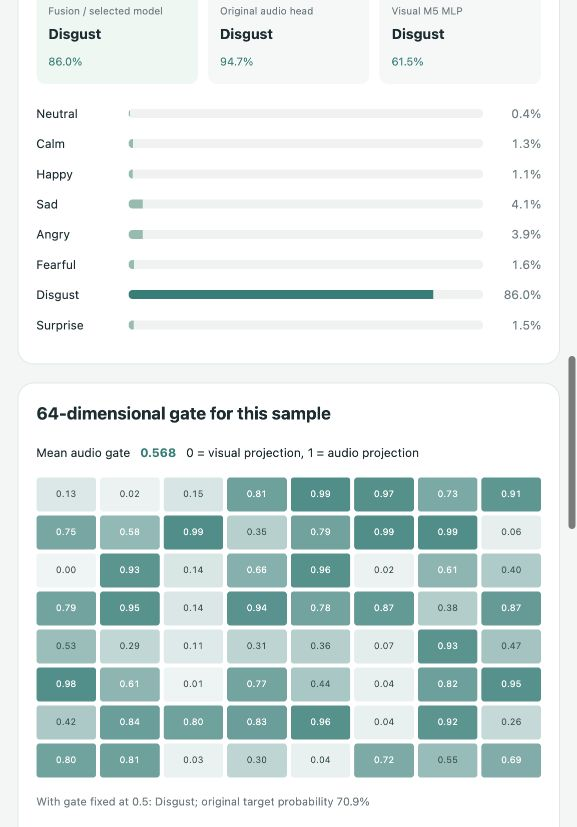

# Multimodal Emotion Recognition

**Group 13 · Pattern Recognition Systems · 2026**

An audio–visual emotion recognition system combining speech encoders, facial features and multimodal fusion. This repository contains the M1–M5 source code, experiment metrics, prediction records, figures and operation guides. Features are generated locally; trained weights are supplied in a separate model download, organized and named by M1–M5.

The main study uses **1,440 paired RAVDESS speech recordings**, **24 actors** and **eight emotion classes**, with a shared actor-independent **960 / 240 / 240** train / validation / test split.

## Run the system

Use Python **3.11 or 3.12**:

```bash
git clone --depth 1 https://github.com/caiji666/prs-group13-multimodal-emotion-recognition.git
cd prs-group13-multimodal-emotion-recognition
python -m venv .venv
source .venv/bin/activate
python -m pip install -r requirements.txt
```

Download `Group13_M1-M5_Model_Weights_20261031.zip` from the [release page](https://github.com/caiji666/prs-group13-multimodal-emotion-recognition/releases/tag/submission-2026-10-31-complete-models), then prepare weights and launch:

```bash
python scripts/restore_models.py --archive /path/to/Group13_M1-M5_Model_Weights_20261031.zip
python demo/setup_assets.py
python project.py check --verify
python project.py demo
```

Windows PowerShell: activate with `.venv\Scripts\Activate.ps1`. Open **http://127.0.0.1:8765**. Upload a short video containing speech, select a fusion method, and inspect emotion probabilities and explanations. Audio and visual features are extracted on the local machine for each video.



## Generate features locally

```bash
python project.py extract --video /path/to/video.mp4 --output data/my_clip
```

This writes WavLM audio, Haar DWT visual features and metadata under the requested local directory. The [feature generation guide](docs/feature-generation.md) covers batch RAVDESS exports, M1/M2/M3/M4 extraction, and the optional development cache for validation replay and fusion training.

## Repository guide

| Path | Contents |
|---|---|
| `project.py` | Check weights, launch the interface, extract features, run tests and audit results |
| `audio/handcrafted/` | **M1:** 48D audio extraction, preprocessing/classifier and representation comparisons |
| `audio/learned/` | **M2:** CNN, BiLSTM, Transformer and WavLM training, inference and feature export |
| `visual/handcrafted/` | **M3:** face sampling/alignment, 320D Haar DWT extraction and SVM classification |
| `visual/visual_deep_learning/` | **M4:** MobileNetV3 / ResNet18 notebooks and training logs |
| `multimodal_fusion/` | **M5:** fusion models, training code, final metrics, predictions and diagnostic outputs |
| `demo/` | Video upload, local feature extraction, prediction, explanations and external evaluation |
| `experiment_records/` | Shared configurations, metrics, histories, predictions and provenance |
| `assets/model_manifest.json` | Model paths, sizes and SHA256 checksums for the separate weights download |
| `docs/` | Operation guide, feature generation, evaluation protocol and result index |
| `submission_documents/` | Group report, proposal and available presentation decks |
| `scripts/` | Feature generation, model restoration, audits and lightweight ZIP packaging |

## Main results

Final fusion inputs are **WavLM R05 audio (128D)** and **handcrafted visual features (320D)**. Neural results are mean ± sample SD over seeds 42, 43 and 44.

| Method | Validation Macro-F1 | Test Macro-F1 |
|---|---:|---:|
| Original WavLM audio head | 0.8312 | 0.8321 |
| Concatenation | **0.8693 ± 0.0064** | 0.8116 ± 0.0057 |
| Gated fusion | 0.8553 ± 0.0142 | 0.8213 ± 0.0111 |
| Cross-attention | 0.7642 ± 0.0138 | 0.7406 ± 0.0297 |
| Validation-weighted decision fusion | 0.8654 | **0.8349** |

Concatenation was validation-selected among the three primary neural fusion methods. The final study contains **130 configurations**: 93 neural fits, 27 SVM configurations and 10 fixed probability pipelines. Results describe the fixed actor split, whose test actors had been observed during earlier development.

See [results and evidence](docs/results.md), the [130-run table](multimodal_fusion/results/m5_final_delivery_20261027/summary.md), and the [evaluation protocol](docs/protocol.md). The separate CREMA-D pilot records external-video results.

## Verify and package

```bash
python project.py test --suite core
# After restoring model weights:
python project.py audit
python scripts/package_submission.py --kind submission --output dist/Group13_Code_Results_20261031.zip
```

The source/submission ZIP contains code, results and documents. Model weights have their own ZIP. Feature arrays, extracted frames, caches and raw media stay local. See the [operation guide](docs/operation-guide.md) and [delivery contents](docs/delivery.md).

## Team and individual contributions

Group members are listed in the [project proposal](submission_documents/Group13_Project_Proposal.pdf); module responsibilities follow Appendix E (Team Contributions) of the [final report](submission_documents/Group13_Final_Report.docx).

| Member | Student ID | Module · code | Contribution |
|---|---|---|---|
| Agarwal Hritik Kumar | A0353874R | **M1** · Handcrafted audio features and audio representation comparison · `audio/handcrafted/` | Implemented and validated handcrafted audio preprocessing and 48-D feature extraction; ran the 270-fit classifier/preprocessing sweep, grouped tuning and audio representation comparisons; exported features, OOF probabilities and models; wrote the corresponding M1 report sections. |
| Zhang Yurun | A0330891A | **M2** · Deep learning audio recognition, CNN/BiLSTM/Transformer comparison and WavLM adaptation · `audio/learned/` | Built audio preprocessing, training-only augmentation and MFCC extraction; compared 1D-CNN, BiLSTM and Transformer for eight-class emotion recognition; adapted frozen WavLM with attentive statistics pooling and residual temporal convolution, reaching validation/test macro-F1 of 0.831/0.832; recorded 48 reproducible training runs and delivered aligned sequence features, pooled representations, emotion probabilities and documentation for audio feature combination and multimodal fusion. |
| Lu Yujing | A0351286B | **M3** · Handcrafted visual modelling and visual representation integration and comparison · `visual/handcrafted/` | Implemented 16-frame visual preprocessing, alignment, Full-320 DWT-SVM and augmentation/crop/grid studies; integrated handcrafted and learned visual representations; exported features, OOF probabilities and models; wrote the corresponding M3 report sections. |
| Ma Bofei | A0314662H | **M4** · Learned visual representations and visual encoder comparison · `visual/visual_deep_learning/` | Implemented and compared three learned visual encoders on the shared 16-frame face sequences: frozen ImageNet-pretrained MobileNetV3-Small and ResNet18 with mean pooling, and ResNet18 with BiLSTM; selected MobileNetV3-Small with mean pooling (validation macro-F1 0.3771) as the learned visual model for feature extraction and fusion. |
| Jiang Yushan | A0353592X | **M5** · Multimodal fusion, system integration, experimental evaluation and interpretation · `multimodal_fusion/`, `demo/` | Implemented fusion methods, feature alignment and interpretability diagnostics; conducted baseline comparisons, ablations and external evaluation; developed the video demonstration interface and contributed report sections. |
