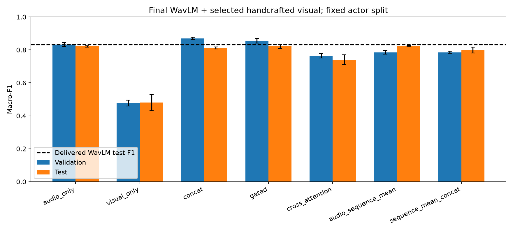

# Results and evidence

## Final RAVDESS fusion study

The primary inputs are selected WavLM R05 audio (128D) and handcrafted visual features (320D). The final study contains 130 configurations: 93 neural fits, 27 SVM configurations and 10 fixed probability pipelines.

| Method | Validation Macro-F1 | Test Macro-F1 |
|---|---:|---:|
| Original WavLM R05 head | 0.8312 | 0.8321 |
| Retrained audio MLP control | 0.8325 ± 0.0127 | 0.8209 ± 0.0038 |
| Retrained visual MLP control | 0.4767 ± 0.0179 | 0.4806 ± 0.0493 |
| Concatenation | 0.8693 ± 0.0064 | 0.8116 ± 0.0057 |
| Gated fusion | 0.8553 ± 0.0142 | 0.8213 ± 0.0111 |
| Cross-attention | 0.7642 ± 0.0138 | 0.7406 ± 0.0297 |
| Validation-weighted decision (audio weight 0.60) | 0.8654 | 0.8349 |
| Audio residual + auxiliary supervision | 0.8536 ± 0.0022 | 0.8302 ± 0.0053 |
| Bidirectional cross-attention | 0.8628 ± 0.0104 | 0.8265 ± 0.0198 |

Neural entries are mean ± sample SD over seeds 42–44. The original head and weighted decision pipeline are fixed single configurations. Concatenation was validation-selected among the three primary neural fusion methods. The stronger validation scores did not translate into a consistent test advantage over the original audio head. The fixed test actors had already been observed in earlier development.

- [All configurations and individual records](../multimodal_fusion/results/m5_final_delivery_20261027/summary.md)
- [CSV comparison](../multimodal_fusion/results/m5_final_delivery_20261027/summary.csv)
- [Aggregate metrics](../multimodal_fusion/results/m5_final_delivery_20261027/aggregate.json)
- [Study plan](../multimodal_fusion/results/m5_final_delivery_20261027/plan.json)
- [Evaluation lock and checkpoint hashes](../multimodal_fusion/results/m5_final_delivery_20261027/evaluation_lock.json)
- [Prediction/metric verification](../multimodal_fusion/results/m5_final_delivery_20261027/validation_report.json)
- [Repair / harm relative to the original audio head](../multimodal_fusion/results/m5_final_delivery_20261027/repair_harm_summary.json)
- [Gate diagnostic summary](../multimodal_fusion/results/m5_final_delivery_20261027/gate_summary.json)



Each run directory contains `run.json`, metrics, per-sample validation/test predictions and notes. Trainable runs also contain a checkpoint and neural training history. Confusion matrices and class metrics are stored within the metrics files. SVM decision scores are separate from probability outputs.

## Audio and visual module studies

| Module | Result location |
|---|---|
| M1 preprocessing, classifiers and audio representation comparison | [Audio study guide](../audio/handcrafted/README.md), `audio/handcrafted/outputs/metrics/` |
| M2: 48 encoder / refinement records and final tests | [Shared experiment index](../experiment_records/summary.md), `experiment_records/M2_*/` |
| M3: visual handcrafted, ablations and representation comparison | [Visual study guide](../visual/handcrafted/README.md), `visual/handcrafted/outputs_visual_comparison/` |
| M4: three deep visual models and training logs | [Deep visual results](../visual/visual_deep_learning/readme.md) |
| Earlier M5 feature-version studies | [Shared experiment index](../experiment_records/summary.md), `experiment_records/M5_*/` |

## External-video pilot

A fixed set of 24 CREMA-D videos covers four actors and six emotions. All videos processed successfully; all 384 sampled frames had a detected face. The original audio model classified 10/24 correctly; concatenation and gated fusion classified 9/24 each. Eleven fixed methods produced 264 predictions.

The pilot measures a small cross-dataset sample with unchanged RAVDESS models. It has its own [protocol and report](../demo/external_evaluation_20261027/REPORT.md), [prediction CSV](../demo/external_evaluation_20261027/predictions.csv) and [summary JSON](../demo/external_evaluation_20261027/summary.json).

## Verification commands

```bash
python project.py check --verify
python project.py test
python project.py audit
```

The [shared protocol](protocol.md) defines feature versions, actor splits, metric conventions and selection. The [operation guide](operation-guide.md) supplies reproduction commands.
