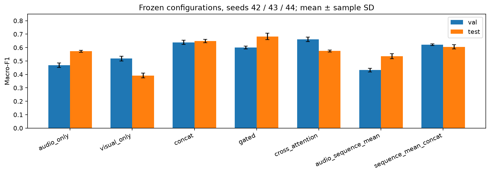
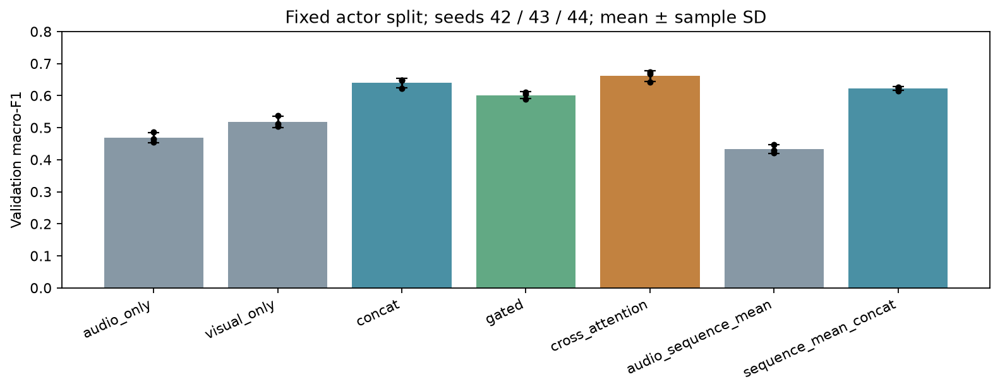

# M5 Fusion Results and Remaining Work

Published: 2026-10-20. Historical frozen feature exports, fixed shared actor split. [All run records](../../summary.md).

## Main results / 主要结果

Mean across seeds42/43/44; sample SD uses ddof=1. Matched unimodal controls retrain an MLP on frozen features, and are distinct from the supplied original heads.

| Pipeline | Validation macro-F1 | Test macro-F1 |
|---|---:|---:|
| audio_only | 0.4682 ± 0.0163 | 0.5730 ± 0.0075 |
| visual_only | 0.5178 ± 0.0172 | 0.3918 ± 0.0174 |
| concat | 0.6392 ± 0.0154 | 0.6480 ± 0.0126 |
| gated | 0.6011 ± 0.0109 | 0.6831 ± 0.0243 |
| cross_attention | 0.6608 ± 0.0163 | 0.5749 ± 0.0072 |
| audio_sequence_mean | 0.4325 ± 0.0136 | 0.5346 ± 0.0188 |
| sequence_mean_concat | 0.6224 ± 0.0062 | 0.6057 ± 0.0158 |

Cross-attention was selected by validation. Gated achieved the highest observed test mean, but test ranking was not used to change selection. Cross-attention did not preserve its validation advantage. / Cross-attention按验证集预选，门控测试较高是描述性结果，未据此改选模型。

## Decision fusion / 决策融合

| Pipeline | Audio weight | Validation macro-F1 | Test macro-F1 |
|---|---:|---:|---:|
| upstream_audio | 1.00 | 0.4565 | 0.5445 |
| upstream_visual_assumed_order | 0.00 | 0.3033 | 0.2150 |
| decision_equal | 0.50 | 0.4906 | 0.5579 |
| decision_tuned | 0.15 | 0.5455 | 0.4741 |

Visual probability class order was explicitly confirmed by the teammate via the user after initial evaluation; input checksum and saved probability values were verified unchanged. No permutation search or metric rerun was used. The original visual head test F1=0.2150 is distinct from the retrained visual MLP test mean0.3918. / 类别顺序已确认，当前重点是原视觉分类头、导出来源与泛化表现，而非猜列排列。

## Interpretation / 解释分析

- Fusion uses complementary information: zeroing either modality reduces validation performance; wrong visual pairing especially harms attention. This is feature-input sensitivity, not causal attribution.
- Average repair/harm counts relative to the validation-preselected visual control: concat52.33/26.00, gated50.33/30.67, cross_attention48.00/18.33 per seed.
- Learned-attention validation mean0.6608 versus uniform-attention0.6627: do not claim that learned temporal alignment explains the gain.
- Gate noise responses do not demonstrate reliable-modality switching. Gate means are not contribution percentages.
- Test actor17 visual control F1=0.0623, audio control0.5602; actor effects warrant preprocessing and provenance checks, but do not prove the cause.
- Targeted hidden32/dropout0.4 trials did not meet the prespecified0.02 validation improvement gate for more seeds. The isolated best tuning score0.6828 is not promoted as the main result.





## Input and reproduction / 输入与复现

- Audio pooled176=48 handcrafted+128 learned; attention audio sequence128D. Visual pooled576 and16×576 sequence. Cross-attention and pooled baselines differ in representation and parameter count.
- Historical audio source matches the original checkpoint associated with M2_encoder_transformer_s42_20261015_00. M2 has since promoted another encoder; these results do not use that new export.
- Class order: neutral, calm, happy, sad, angry, fearful, disgust, surprise. Actor split is shared16/4/4. Visual16 tokens are assumed valid pending upstream provenance.
- Unknown M1/M4 run IDs, upstream classifier architecture and calibration metadata remain null. M5 checkpoint weights and raw features are not uploaded; see [artifact inventory](large_artifact_inventory.json) for hashes and retrieval status.
- Source snapshots, patch, input manifest, per-run predictions and histories permit review. Run the reproduction code only after obtaining the exact feature version; do not silently use the newest M2 default.

```bash
cd multimodal_fusion
python -m unittest discover -s tests -v
python -m fusion.feature_pilot --output results/new_pilot --seed 42
python -m fusion.study --pilot results/new_pilot --output results/new_study
python -m fusion.study_diagnostics --study results/new_study --pilot results/new_pilot
```

## Remaining work / 尚未完成

1. Confirm original visual head/checkpoint/export identity and preprocessing; the class order itself is confirmed.
2. Obtain final M3 A/B/A+B visual selection; current results use a learned-only MobileNet candidate.
3. Complete fixed-head audio48/128/176 and handcrafted/learned/combined visual representation ablations.
4. Parameter-matched projection/residual controls and uniform-attention retraining to isolate attention selection effects.
5. Raw audio/video degradation and external manually labelled samples/demo. Current noise experiments are feature-level only.

The test set is already exposed. Any subsequent test-informed model change must be recorded as exploration, not development on an unseen test set. / 测试集已查看，后续改方案须披露测试暴露。

## Validation / 校验

Publication validator recomputes fixed-eight-class metrics from every prediction CSV, checks summary rows against run.json, verifies shared split/classes/IDs and preserves existing M2 records. Unknown values are not guessed. Synthetic engineering tests are not counted as formal RAVDESS training runs.
